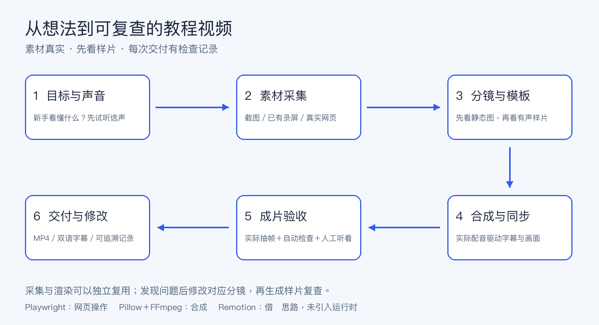
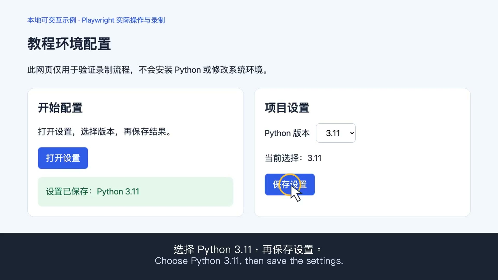
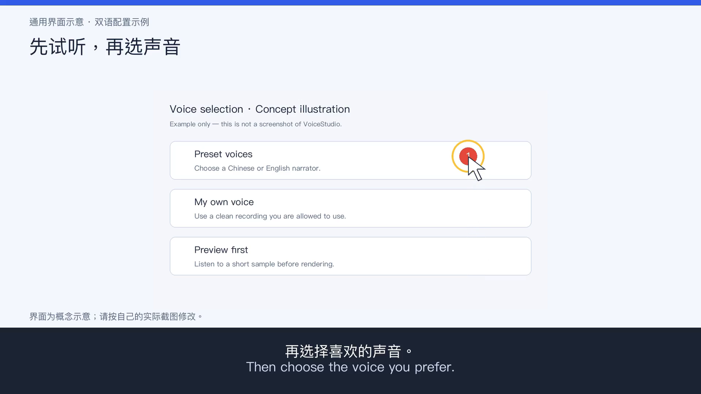
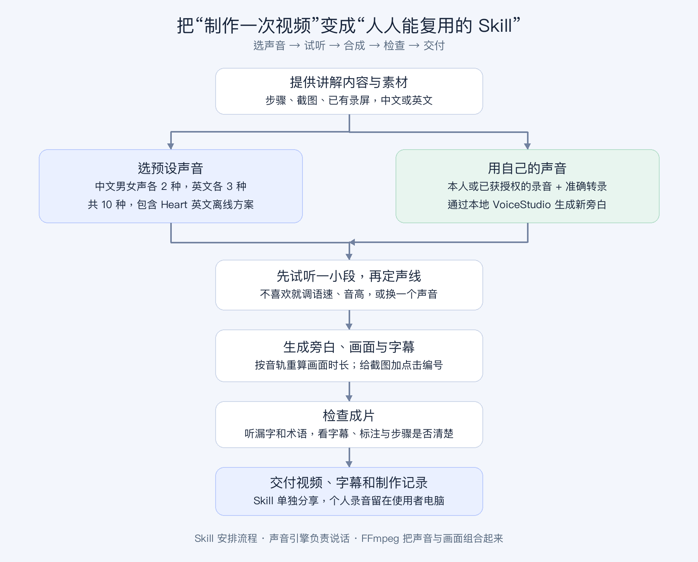
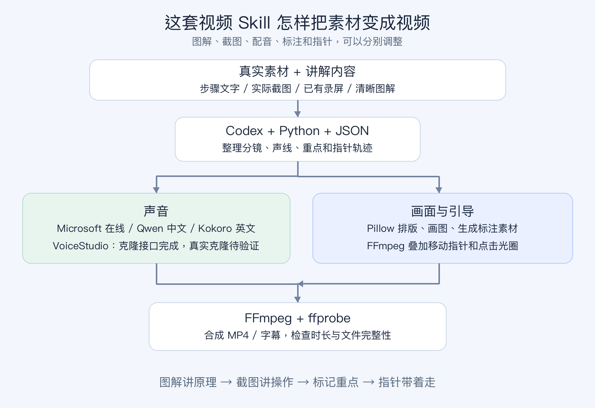

# 中英文配音教程视频 Skill

**把步骤、截图、已有录屏或真实网页操作，做成带配音、双语字幕、操作指引和验收记录的教程视频。**

这是给 Codex 使用的可复用 Skill。你负责提供内容、选择声音；AI 助手安排分镜并运行脚本，输出 MP4、字幕和制作记录。主要在 macOS 上验证。

> 如果你是第一次了解这个项目：先看下面的示范，再看流程图。安装说明在后面。

## 新增：先预览、真实采集、逐镜验收

本次把 Remotion 的预览与组件复用思路、Anything2Explainer 的成片验收思路，以及 Playwright 的真实素材采集落到了脚本中。**渲染器仍是 Pillow + FFmpeg，未集成 Remotion/React。**



[可编辑 Excalidraw 源图](docs/quality-workflow.excalidraw) · [本次借鉴与实现说明](narrated-tutorials/references/design-influences.md)

- **先看效果：**storyboard 不生成新配音；preview 只制作选定分镜，减少整片返工。提供软件操作、原理流程、简洁交付 3 个模板。
- **采集真实网页：**Playwright 实际点击、选择并等待结果，连续采集画面；动作可绑定实际配音时间。桌面软件仍需其他录屏工具。
- **交付有依据：**每次成片自动生成 review.html、review.json 和关键帧总览，核对媒体、字幕时间与已标记区域遮挡；听感、术语及操作含义保留人工检查。

[播放新版示范：承岳配音＋真实网页操作＋双语字幕](docs/browser-demo/video.mp4)

[](docs/browser-demo/video.mp4)

页面是可交互的本地教学演示，实际完成“打开设置→选择 3.11→保存”；指针与点击光圈为教学覆盖层，旁白为 AI 合成。**这不是 Cursor/PyCharm 安装录屏。**

[下载后打开验收页](docs/browser-demo/review.html) · [自动检查记录](docs/browser-demo/review.json) · [实际目标截图](docs/browser-demo/step-002.png) · [可编辑采集计划](narrated-tutorials/assets/browser-plan.example.json)

GitHub 不直接运行 HTML；下载仓库后本地打开验收页。详细用法：[模板与预览](narrated-tutorials/references/preview-and-templates.md)、[Playwright 素材采集](narrated-tutorials/references/browser-capture.md)、[验收标准与限制](narrated-tutorials/references/quality-review.md)。

## 原有截图与指针示范

[播放：中文配音 + 中英双语字幕 + 移动指针](docs/demo/video.mp4)

[](docs/demo/video.mp4)

示范使用通用界面示意图、后期指针动画和 AI 合成旁白，**不是实机录屏**。可编辑分镜在 [examples/bilingual.json](examples/bilingual.json)，可修改声线、字幕、标记和指针目标。

## 能做什么

- 中文、英文配音，先试听再选声音。目前有 **10 种预设**：中文女声、中文男声各 2 种，英文女声、英文男声各 3 种；清澄已按创建者反馈移除。
- 单语或中英双语字幕，直接显示在画面上，同时导出 SRT、VTT。
- 根据每句实际配音安排字幕、画面和指针；更换声线后重新计算时间。
- 截图编号、高亮框、移动指针、点击光圈；也可导入已有录屏或配音。
- 可选接入本地 VoiceStudio，使用本人或已获授权的录音。

**能力边界：**现有录音需要准确的字幕时间码；此版本没有自动听写、逐字对齐或桌面录屏器。VoiceStudio 适配器通过了协议测试，真实模型的声音克隆效果尚未完成验证。

当前声音目录：

| 类别 | 保留声线 |
|---|---|
| 中文女声 | 晓晓、知晴 |
| 中文男声 | 承岳、明朗 |
| 英文女声 | Aria、Sonia、Heart |
| 英文男声 | Guy、Ryan、Brian |

[再看英文 Heart 完整示范](docs/demo/english-heart.mp4)（步骤卡片与概念图，AI 合成旁白）。

## 先听，再选择

新项目没有指定声音时，助手会主动在对话中显示 2–3 个可点击播放的短音频，等你回复名字后再制作。想多听几个可以说“全部给我听”；明确说“用晓晓”或“沿用上次”时直接使用，不重复选声。

Skill 内置 10 段约 9–19 秒的通用 AI 合成样音。承岳已由创建者试听选定并替换原云希，修远已移除；其他使用者可按自己的听感选择。**试听不联网，也不需要先安装声音模型。** 制作新旁白时才需要对应声音引擎；固定样音不代表模型已经安装，也不保证 Qwen 在新文本上保持同一声纹。

| 类别 | 点击文件试听 |
|---|---|
| 中文女声 | [晓晓](narrated-tutorials/assets/auditions/zh-xiaoxiao-broadcast.mp3) · [知晴](narrated-tutorials/assets/auditions/zh-zhiqing-youth.mp3) |
| 中文男声 | [承岳](narrated-tutorials/assets/auditions/zh-chengyue-steady.mp3) · [明朗](narrated-tutorials/assets/auditions/zh-minglang-youth.mp3) |
| 英文女声 | [Aria](narrated-tutorials/assets/auditions/en-aria-clear.mp3) · [Sonia](narrated-tutorials/assets/auditions/en-sonia-british.mp3) · [Heart](narrated-tutorials/assets/auditions/en-heart-local.mp3) |
| 英文男声 | [Guy](narrated-tutorials/assets/auditions/en-guy-steady.mp3) · [Ryan](narrated-tutorials/assets/auditions/en-ryan-friendly.mp3) · [Brian](narrated-tutorials/assets/auditions/en-brian-conversation.mp3) |

下载后可以本地打开 `narrated-tutorials/assets/auditions/index.html`：先播放，再点击“选这个声音”，把页面显示的语句回复给 Codex；也可以下载声线配置附到对话中。网页不会自动发消息，也不会自动播放。

只想先试听，用 Python 3.11+ 从仓库根目录运行，不必先安装制作依赖：

```sh
python3 narrated-tutorials/scripts/studio.py listen --language zh --output auditions
python3 narrated-tutorials/scripts/studio.py listen --language en --gender female --output auditions
```

会导出 MP3、筛选试听页、可内嵌 Markdown 和音频路径。宿主支持音频播放器时，助手应直接显示音频；其他宿主可以用导出的试听页。

[查看主动试听与选声流程](narrated-tutorials/references/voice-selection.md)。

## 制作过程



[编辑流程图（Excalidraw）](docs/workflow.excalidraw) · [查看字幕同步流程](docs/subtitle-sync.png)

字幕按每句实际 PCM 音轨起止计时，原文和译文共用时间码。分镜中间音轨使用 PCM，拼接时保留时间间隔，最终只编码一次 AAC，减少多段拼接产生的累积偏差。这是按句同步，仍需抽查术语、漏字、切段和结尾。

## 用了哪些工具

| 工具 | 一句话作用 |
|---|---|
| Codex / SKILL.md | 读懂要求，安排分镜和制作步骤 |
| Python / JSON | 保存项目设置并调用制作工具 |
| Playwright / Chromium（可选） | 实际操作网页、连续采集画面、保存截图与动作记录 |
| reviewing.py / HTML | 生成实际成片关键帧与验收反馈页 |
| Pillow | 排版截图，画编号、标记和指针素材 |
| FFmpeg / ffprobe | 合成视频、音频、字幕和指针，检查输出 |
| edge-tts | 调用 Microsoft 在线预设配音；会发送旁白文本 |
| Qwen3-TTS / MLX-Audio | 在 Apple Silicon 本机按描述设计中文声音 |
| Kokoro-ONNX | 在本机生成英文 Heart 女声 |
| VoiceStudio 本地接口 | 可选的参考声音合成路径；真实克隆待验证 |
| Excalidraw / SVG | 让流程图可以继续编辑 |



详细状态与来源见 [工具清单](narrated-tutorials/references/toolchain.md) 和 [第三方来源](narrated-tutorials/references/sources.md)。模型、依赖与在线服务有各自的使用条件；仓库不捆绑模型权重。

## 装到 Codex

1. 下载本仓库（GitHub 的 **Code → Download ZIP**），或 `git clone`。
2. 把里面的 **narrated-tutorials 文件夹**放到自己的 `~/.codex/skills/` 中。
3. 在新对话中输入：

```text
请用 $narrated-tutorials，把我的步骤做成中文教程视频。
先让我试听声音，使用中英双语字幕，截图加编号，操作位置用移动指针指出。
```

Skill 是工作说明和脚本，不会自动安装声音模型。内置试听可先使用；首次制作新视频时，再准备下面的运行环境。

## 先跑通一个最小示例

需要 Python 3.11+、FFmpeg（含 ffprobe）和中文字体。macOS 自动寻找 PingFang；字体未找到时可传 `--font /path/to/font.ttc`。已有工具可直接使用。

在仓库根目录运行：

```sh
python3 -m venv .venv
.venv/bin/python -m pip install -r narrated-tutorials/scripts/requirements.txt
.venv/bin/python narrated-tutorials/scripts/studio.py doctor
.venv/bin/python narrated-tutorials/scripts/studio.py voices
```

仅当你同意把示例旁白发送给 Microsoft 在线语音服务时运行：

```sh
.venv/bin/python narrated-tutorials/scripts/studio.py render examples/bilingual.json --output result --allow-online
```

打开 `result/preview.html` 查看成片，`result/review.html` 复查实际关键帧与检查结果。重复生成到相同目录时，确认需要替换再加 `--overwrite`。不使用在线服务时，可另行配置 [Qwen 中文声音设计](narrated-tutorials/references/qwen-design.md)、[离线 Heart 英文声音](narrated-tutorials/references/usage.md) 或导入已有音频。

## 可以怎样调整

| 需要改什么 | 改哪里 |
|---|---|
| 旁白、截图、双语译文、指针轨迹 | 自己的项目 JSON；参考 examples/bilingual.json |
| 选择声线、语速、音高 | 项目的 voice；可选预设在 assets/voices.json |
| 颜色、帧率、指针大小与停留 | 项目的 style；参考 assets/style-default.json |
| 本地模型和解释器路径 | 自己电脑上的 local-engines.json，不上传 |
| 使用自己的录音 | [VoiceStudio 配置说明](narrated-tutorials/references/voicestudio.md) |

完整说明：[项目与运行](narrated-tutorials/references/usage.md) · [字幕](narrated-tutorials/references/subtitles.md) · [图解、标记与指针](narrated-tutorials/references/visual-style.md)。

## 开发验证

```sh
.venv/bin/python -m unittest discover -s tests -v
```

已有 40 项行为测试，覆盖无需联网的内置试听、语言/性别筛选、样音损坏与过期检查、字幕时间码、最终画面的字幕与指针、连续 20 段拼接，以及 VoiceStudio 本地接口的请求和失败处理。测试使用本机临时服务和合成纯音，不需要真人录音或下载声音模型；需要 FFmpeg 和中文字体。新增预览、模板、流程组件、验收告警与真实 Chromium 操作测试；可选 Playwright/浏览器缺失时，真实采集集成项会明确跳过。完整覆盖需先按网页采集说明准备可选依赖。

此版本在 macOS 验证，尚未验证所有系统和所有 AI 助手。真实声音克隆未完成模型层面的实测。

## 共享范围

仓库只包含 Skill、脚本、通用合成试听、通用示例、示范视频、流程图和测试。个人录音、历史业务截图、凭证、本机配置、模型权重和生成缓存不在共享范围内。

代码未另行声明开源许可证；本次用于展示与交流。第三方服务、模型和依赖的许可不由本仓库替代。
